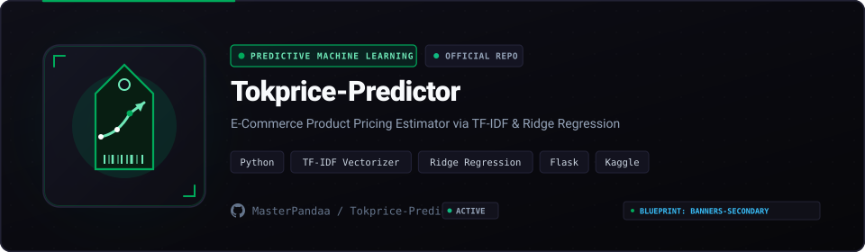

<p align="center">
  
</p>

<p align="center">
  
  
  
  
  <a href="LICENSE"></a>
</p>

## Overview

E-commerce merchants frequently misprice new products, either diminishing sales velocity through overpriced margins or sacrificing profits through underpricing. Tokprice-Predictor is a machine learning web application that predicts optimal product pricing and sales volumes for **Tokopedia** listings.

Trained on an open dataset of **50,000 Tokopedia products** published on Kaggle, the model evaluates Indonesian product titles using **TF-IDF n-grams** paired with regularized **Ridge Regression** to generate explainable pricing recommendations.

---

## Empirical Model Performance

| Metric | Scikit-Learn Pipeline Result |
| :--- | :--- |
| **Model Algorithm** | Ridge Regression with L2 Regularization |
| **Coefficient of Determination (R²)** | **0.78** |
| **Root Mean Squared Error (RMSE)** | **42.3** |
| **NLP Feature Extraction** | Word and Char n-gram TF-IDF (10,000 features) |
| **Dataset Volume** | 50,000 scraped Tokopedia product listings |

---

## Core Capabilities

- **Indonesian NLP Text Mining**: Extracts meaningful brand, specification, and product type signals from informal marketplace titles.
- **Regularized L2 Pricing**: Prevents feature weight explosion on rare keywords using cross-validated Ridge regularization.
- **Interactive Flask Web Client**: Clean pricing evaluation interface with instant calculation and price range confidence envelopes.

---

## Quickstart

```bash
git clone https://github.com/MasterPandaa/Tokprice-Predictor.git
cd Tokprice-Predictor
pip install -r requirements.txt
python app.py
```
Open `http://localhost:5000` in your browser.

---

## License

This project is licensed under the [MIT License](LICENSE).
